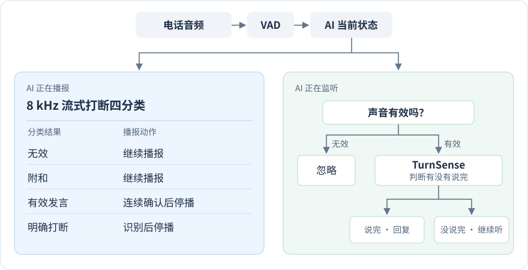

# 全双工语音通话 Demo

[开始通话](https://eeexile-duplex-qwen-20261109.sublimeshell4.chatgpt.site)

接通预约助手，在 AI 说话时试试「对对对」或「等一下」。实时字幕显示用户发言，Qwen 生成文字与语音回复。在线版需使用本人的 ChatGPT 账号登录，每次最多体验三分钟。

## Qwen 在线版

使用阿里云百炼 API：`qwen3.5-omni-flash` 生成对话和语音，`qwen3-asr-flash-realtime` 实时转写并更新字幕。麦克风音频通过云端后端连接模型，API Key 保存在后端。换电脑后也能打开，无需启动本机服务。

AI 播报期间持续听取用户声音：先短暂停顿，附和后继续说，明确打断或持续发言则停播。在线版按转写文本和停顿判断；本地模型版使用声学分类模型与 TurnSense。

[在线版后端源码](qwen-online-worker.mjs) · [本地模型版源码与启动说明](local-model-demo/)

## 系统架构

模型方案中，播报时区分以下四类；监听时先判断声音是否有效，有效语音交给 TurnSense 判断是否说完。

| 分类 | 听到的声音 | 播报怎么处理 |
| --- | --- | --- |
| 0 · 无效 | 背景噪声或背景人声 | 继续播报 |
| 1 · 附和 | 「对对对」 | 停一拍，接着说 |
| 2 · 有效发言 | 「我想再查一下……」 | 连续判为有效后停播 |
| 3 · 明确打断 | 「等一下，我打断一下」 | 识别后停播，让用户说 |

## 自行部署在线版

将 `qwen-online-worker.mjs` 部署为 Cloudflare Worker ES module，在服务端配置 `DASHSCOPE_API_KEY`、`DASHSCOPE_BASE_URL`、`DASHSCOPE_REALTIME_URL`、`BAILIAN_CHAT_MODEL`、`BAILIAN_ASR_MODEL`。两个模型名分别为 `qwen3.5-omni-flash` 和 `qwen3-asr-flash-realtime`，接口地址使用百炼控制台对应地域的地址。

网页和 WebSocket 接口由同一个 Worker 提供。自行部署时为入口配置访问限制；当前在线站点通过个人 ChatGPT 登录访问。
