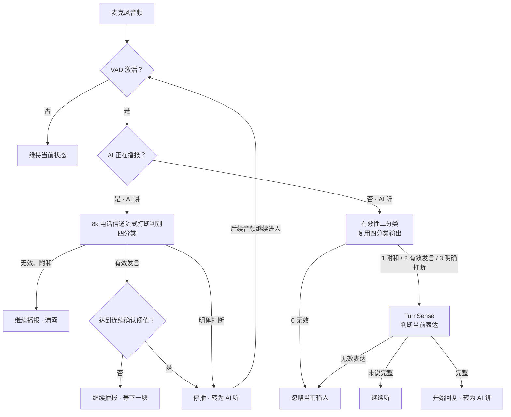

# 全双工语音交互决策 · Full-duplex Voice Interaction

AI 播报时遇到插话，要判断是否停下来。AI 听用户说话时，要判断是否该接话。这个浏览器演示把 VAD 之后的两条链路串起来，逐步展示每个判断如何改变对话状态。

[在线体验 Demo](https://eeexile.github.io/full-duplex-barge-in-demo/) · [页面源码](index.html)

## 团队成果

团队围绕全双工语音交互中的误打断问题，构建了覆盖噪声、附和、有效发言和明确打断的场景数据，迭代了流式打断判别模型，并结合停播策略开展场景评测。这个演示进一步串联了播报侧的打断判断和监听侧的轮次判断。

## 系统框图

| 状态 | 判断逻辑 | 动作 |
| --- | --- | --- |
| AI 讲 | 8k 电话信道流式打断四分类 | 无效和附和继续播。有效发言连续命中 2 次或 3 次后停播。明确打断当次触发停播。 |
| AI 听 | 将四分类映射为有效或无效。只有有效才交给 [TurnSense](https://github.com/Bairong-Xdynamics/TurnSense) | 完整就接话，未完整就继续听，无效表达就忽略。 |

监听侧的「有效」表示音频可以交给下一阶段判断。比如「嗯嗯」可以通过第一关，随后仍可能被 TurnSense 判为无效表达，因此 AI 继续听。

## 试一遍

1. 选择「完整对话 · 打断后继续说」，点击「单步推进」。
2. AI 正在播报时听到「嗯嗯」，继续播。听到「等一下」，触发停播并转入监听。
3. 用户说「我想查一下……」，通过有效性判断，但 TurnSense 判为未完整，AI 继续等。
4. 用户补完「上个月的账单」，TurnSense 判为完整，AI 开始回复并回到播报状态。

页面支持 240 ms 模拟更新，逐步显示 VAD、四分类、二分类、TurnSense 和动作。播报噪声示例还可和持续激活 500 ms 的 VAD 基线对照。也可以下载后直接双击 `index.html`。模型输出与音频事件使用自编样例，浏览器执行路由、类别映射、停播和接话规则。
