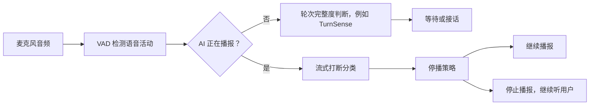

# 全双工语音打断演示 · Full-duplex Barge-in Demo

AI 正在播报时，用户说「嗯嗯」，系统应该继续播。用户说「等一下」，系统应该停下来听。本演示用预设分类序列展示这两种声音怎样触发不同的播放动作。

[打开在线演示](https://eeexile.github.io/full-duplex-barge-in-demo/) · [查看页面源文件](index.html)

## 团队成果

团队围绕全双工语音交互中的误打断问题，构建了覆盖噪声、附和、有效发言和明确打断的场景数据，迭代了流式打断判别模型，并结合停播策略开展场景评测。

## 系统框图

演示从「AI 正在播报，VAD 已激活」开始。每 240 ms 更新一次模拟分类结果，页面展示累计次数和停播时刻。可以切换连续 2 次或 3 次有效发言的确认策略。

| 分类数字 | 含义 | 播报中的动作 |
| --- | --- | --- |
| 0 | 无效声音 | 继续播，清零 |
| 1 | 附和 | 继续播，清零 |
| 2 | 有效发言 | 连续达到阈值后停播 |
| 3 | 明确打断 | 当次触发停播 |

页面同时模拟持续激活 500 ms 后停播的 VAD 基线。噪声和附和场景预期继续播，触发停播记为误打断。普通发言和明确打断场景预期让出话轮。时间轴显示模拟时钟。

## 数据与模型在流程中的位置

训练可以从音频片段及其类别和起止时间出发。流式分类器根据已到达的音频给出类别，决策层结合当前播放状态和连续分类结果控制停播。演示中的全部输入为自编序列，分类结果由预设提供，页面执行停播规则。
